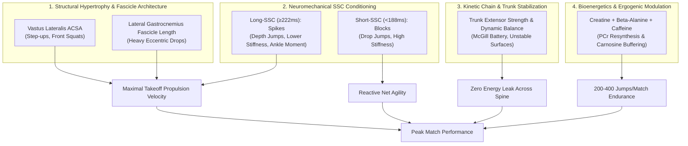

# Integrated Vertical Jump Mastery & Jump Endurance Blueprint for Volleyball

An evidence-based, complex adaptive systems framework for maximizing vertical jump height, spike attack velocity, and match-long repeated jump power in volleyball athletes.



---

## 1. Morphological Targets (Knee & Ankle Specificity)
- **Vastus Lateralis (VL)**: Maximize Anatomical Cross-Sectional Area (ACSA). Step-ups and front squats produce superior VL motor recruitment compared to bilateral back squats ([[wiki/protocols/quad-calf-hypertrophy-fascicle-loading.md]]).
- **Lateral Gastrocnemius (LG)**: Extend Fascicle Length (FL). Longer fascicles increase shortening velocity ($V_{\max}$) in the distal ankle snap. Prescribe heavy eccentric gastrocnemius stretching ([[wiki/concepts/muscle-architecture-jumping.md]]).
- **Avoid Over-investing in Rectus Femoris**: Bi-articular action renders RF mechanically neutral during simultaneous hip/knee extension.

---

## 2. SSC Neuromechanics (Resolving the Stiffness Conflict)
- **For Quick Blocks (Short-SSC $< 188$ ms)**: Train high lower-limb stiffness and minimal contact time via drop jumps from 20–30 cm ([[wiki/concepts/ssc-mechanisms.md]]).
- **For Spike Attacks (Long-SSC $\ge 222$ ms)**: Encourage deeper joint excursion and lower vertical leg stiffness to allow greater propulsion impulse and maximal ankle plantarflexion moment output ([[wiki/contradictions/leg-stiffness-short-vs-long-ssc.md]]).

---

## 3. Kinetic Chain & Trunk Conditioning
- Core stability training does **not** directly increase CMJ jump height ([[wiki/contradictions/core-training-vs-jump-height.md]]).
- Program core exercises to increase trunk extensor isometric strength and dynamic balance (SEBT), ensuring that forces generated at the ground are transmitted cleanly through the torso without energy dissipation ([[wiki/concepts/core-stability-force-transfer.md]]).

---

## 4. Periodized Ergogenic & Bioenergetic Protocol
- **ATP-PCr Engine**: 5 g/day [[wiki/substances/creatine-monohydrate.md]] to maximize rapid cross-bridge cycling and support VL hypertrophy.
- **Glycolytic Buffering**: 3.2–6.4 g/day [[wiki/substances/beta-alanine.md]] across 6 weeks to increase muscle carnosine, sustaining high-intensity repeated jumps across 5-set matches.
- **Acute Neural Drive**: 3–6 mg/kg [[wiki/substances/caffeine.md]] 60 min pre-match to elevate motor unit firing frequency and counteract central fatigue.
- **Redox Caution**: Refrain from high-dose antioxidant megadosing post-training to safeguard mitochondrial adaptation and PGC-1α signaling ([[wiki/contradictions/antioxidants-vs-mitochondrial-adaptation.md]]).

---

## 5. Applied 8-Week Microcycle Template

```text
Day 1 (Mon): VL Hypertrophy & Long-SSC Depth Jumps
  - High Step-Ups: 4 x 6/side (80% 1RM)
  - 40cm Depth Jumps with Arm Swing: 4 x 5 reps (2 min rest)
  - Core McGill Big 3 + Dynamic Balance (SEBT)

Day 2 (Wed): Short-SSC Reactivity & Upper Kinetic Chain
  - Low-Amplitude Reactive Hurdle Bobs: 3 x 10 reps (Short GCT < 188ms)
  - Approach Spike Jumps with Ball Hit: 4 x 6 reps
  - Heavy Eccentric Gastrocnemius Heel Drops: 4 x 8 reps (4s eccentric)

Day 3 (Fri): Sport-Specific Repeated Jump Endurance
  - 8-Week Progressive Plyometric Phase 4 Circuit ([[wiki/protocols/volleyball-plyometric-8week.md]])
  - Front Squats: 4 x 5 reps (82.5% 1RM)
  - Lateral-to-Vertical Block Sequences: 3 x 8 reps
```

## Cross-References
- All referenced concept, protocol, substance, contradiction, and entity pages in `wiki/`.
